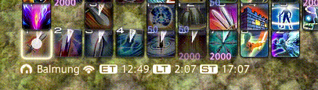
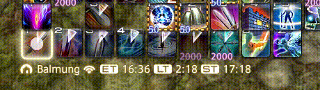
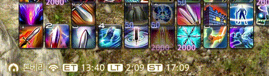

## Download [here](https://github.com/Soreepeong/XivAlexander/releases)
* Use [**Releases**](https://github.com/Soreepeong/XivAlexander/releases) section on the sidebar. Don't download using the green Code button.

# XivAlexander
Latency mitigation and a bunch of modding tools mixed into one giant mishmash of a program.

| Connection | Image |
| --- | --- |
| Korea to NA DC VPN only |  |
| Korea to NA DC XivAlexander enabled |  | 
| Korea to Korean DC Direct connection |  | 

This add-on will make double (or triple if your GCD is 2.50) weaving always possible.

## Quickstart
1. Run `XivAlexanderLoader64.exe` and choose your game. If it is not listed, use **Find game folder**.
2. Choose how to use XivAlexander:
   * **Use now:** apply to a running game, or choose **Start game and apply** and log in through the official launcher. Without installation, this lasts until you close the game.
   * **Automatic loading:** choose **Set up automatic loading** once, then use your usual launcher. To undo installation, choose **Turn off automatic loading**. Restart a running game after installing, updating, or uninstalling.

If several games are running from the selected installation, choose one in the running games list before applying. **Advanced** shows technical details and alternative installation methods.
**[Read more about installation and using XivAlexander without installing.](https://github.com/Soreepeong/XivAlexander/wiki/Installation-and-Load-Once)**

## Building
* Clone with submodules, or run `git submodule update --init --recursive` after cloning; `FFXIV-FontChanger` has a nested submodule.
* This project uses [vcpkg](https://github.com/microsoft/vcpkg) in manifest mode through its MSBuild integration to import dependencies.
  The projects point vcpkg at the overlay triplets in `triplets` (`x64-windows-static` for 64-bit, `x86-windows-static` for 32-bit builds),
  which link everything statically with the v145 toolset; no extra setup is needed for them.
* Build `Release|x64`; it builds
  * `XivAlexander64.dll`, the features, loaded only into the game;
  * `XivAlexanderLoader64.dll`, which runs the loader window for `XivAlexanderLoader64.exe`, follows launchers into the game, and is what gets installed into the game folder as `d3d11.dll`, `dxgi.dll` or `dinput8.dll`;
  * `XivAlexanderLoader32.dll`, loaded into 32-bit game launchers;
  * `XivAlexanderLoader64.exe`.
* Make `Certificate.pfx` and `CertificatePassword.txt` in `Build` directory.

## License
Apache License 2.0
